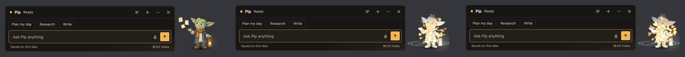
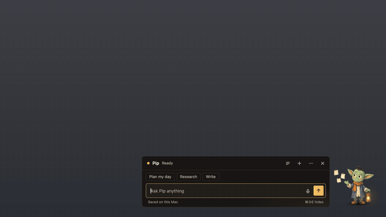
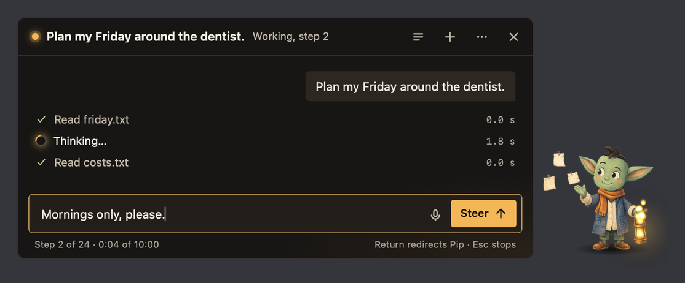
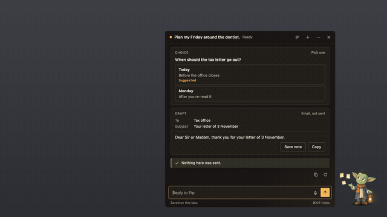
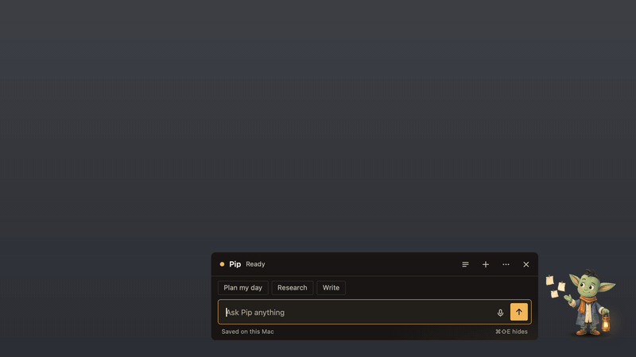
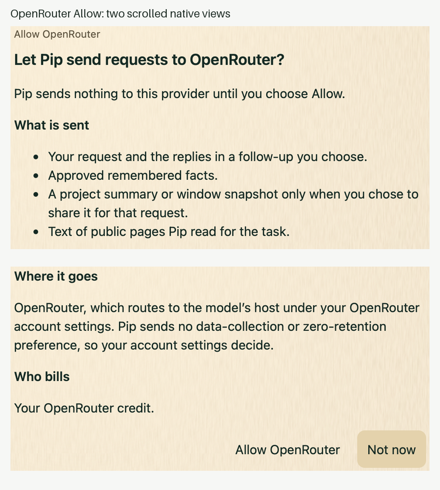

<div align="center">

# Pip

**A small macOS companion for remembered context, research and editable drafts.**

Experimental · Source build · [MIT code & docs](LICENSE)


[Get started](#get-started) · [Privacy](docs/PRIVACY.md) · [Documentation](docs/README.md) · [Contribute](CONTRIBUTING.md)

</div>

Pip keeps a small place for the context you choose to remember and the work you
choose to bring back. Summon it when you need it, review a fact before saving it,
and keep AI-generated writing editable rather than sending it automatically.

Pip is a chat window at the lower right of your screen with a small painted elf
standing beside it. The window is dark with one amber accent and follows your Mac's
light and dark setting. The elf is alive: he breathes, blinks, follows your pointer
and works with a lantern and three scrolls.

> **Experimental alpha, not full v1 acceptance.** The latest alpha, 0.1.0-alpha.2, is a signed and
> notarized Apple-silicon Mac app: download it from the
> [releases page](https://github.com/intelligentrascal/pip/releases), or install it with
> Homebrew (see [Install](#install)). It is early software with the limits listed in
> [status](docs/STATUS.md). You can still build from source; that developer build is unsigned
> and depends on its original project folder.

## Install

Pip needs an Apple-silicon Mac (M1 or later) running macOS 14 or later. It is tested on macOS 26;
macOS 14 is the declared minimum and has not been tested. Intel Macs are not supported.

- **Download.** Open the [latest release](https://github.com/intelligentrascal/pip/releases),
  download `Pip-0.1.0-alpha.2-arm64.dmg`, open it and drag Pip to Applications. A ZIP and
  `SHA256SUMS` are beside it. The app is signed with a Developer ID and notarized by Apple, so
  macOS opens it without any security workaround. It brings its own Node runtime; you install nothing else.
- **Homebrew.** `brew install --cask intelligentrascal/tap/pip-house-elf`.
- **Update.** Pip menu > Check for Updates… offers a newer alpha only after you ask, and installs it
  only after you choose Download and restart. A Homebrew copy updates with
  `brew upgrade --cask pip-house-elf`.
- **Remove.** Quit Pip and drag it to the Trash, or `brew uninstall --cask pip-house-elf`. Your saved
  work in `~/Library/Application Support/Pip` stays until you delete that folder yourself.

Chrome is optional and is used only for task browsing. Pip never installs a browser or developer tool.

## The Lantern chat window

The window is 600 pt wide by default. Drag its left edge to make it 420 to 760 pt wide and
its top edge to set how tall it may grow; Pip remembers both and the window does not move.
It opens small and grows upward as the conversation grows, and the message box never moves.
Answers can include a plan, table, chart, choice, sources, route, fold, pictures, note or
draft, drawn from checked data only; nothing a part shows sends, saves or opens anything by
itself. While Pip works the window shows one row per step with its time and the answer as it
arrives. If you type while he works, Send becomes an amber **Steer** button ("Tell Pip to change
course"): press Return and he changes course after his current step without stopping. Chats lists every conversation; **More** holds
Settings, Feedback, Tracker, Remember and Browser task.

See [Lantern](docs/LANTERN.md) for the sizes, the parts and the see-through material.

## See Pip move

Pip breathes, blinks and follows your pointer. When he arrives, works, finishes a step or
hears a yes, Magic draws light around him; **Settings → Magic** sets how much.


*Recorded in the real native app with Balanced, the default. The pointer path is scripted and
the GIF plays once. [MP4 version](docs/media/magic.mp4).*

| Level | What is drawn |
| --- | --- |
| Calm | Pip moves; nothing else is drawn |
| Balanced (default) | Light and embers around Pip, never over your text |
| Rich | All of it, with the desktop dimmed while he arrives |



*Left to right: Calm, Balanced and Rich at the same moment of his arrival.* Reduce Motion in
System Settings turns every effect off. [Settings → Magic](docs/media/settings-magic.png)
explains the three levels in the app. Nothing about your pointer is stored or sent.

## Watch Pip work, and steer him



*Recorded in the real native app with a scripted stand-in for the model, so no account or AI
request is involved. The typing is automated. The GIF plays once. [MP4 version](docs/media/work.mp4).*



While Pip works, typing turns Send into **Steer**. Press Return and he changes course after his
current step without stopping. [A finished answer](docs/media/answer-parts.png) can hold a plan,
table, choice, draft and note.

## Resize the window



*The edge drags are simulated pointer events on the real window's handles, not a physical mouse.
The GIF plays once. [MP4 version](docs/media/resize.mp4).*

[The widest and narrowest window side by side](docs/media/resize-static.png). Pip remembers both
the width and the most height.

## See the account-free memory flow



*Automated disposable-profile demonstration in the real native app: More → Remember →
Review save → Save fact, then More → Settings → Remembered facts. The local save is real; no AI request occurs.
This is not physical-keyboard proof. The GIF plays once.
[MP4 version](docs/media/remember.mp4).*

[Static equivalent of the reviewed fact and saved list](docs/media/remember-static.png).
The recording demonstrates local memory, not secure deletion or live AI inference.

## What works today

| You want to… | Pip provides | Current boundary |
| --- | --- | --- |
| Remember a preference | Exact-text review, confirmed save, list, edit and Forget | Local storage is unencrypted; Forget is not secure erasure |
| Keep a draft close | Floating Lantern chat window, menu-bar fallback, retained message box, Chats list and a window you can resize | Physical global-shortcut and ordinary Spaces proof retain gaps; the native see-through blur is not driven by a test |
| Watch and steer work | One row per step with its time, the answer as it arrives, Stop, and Steer to change course while Pip works | Steer and resizing are proved with scripted-model fixtures, browser journeys and native size checks; a real mouse drag on the native panel and a live model are not |
| See Pip alive | He breathes, blinks and follows your pointer; Settings > Magic sets Calm, Balanced (default) or Rich light around him, and Reduce Motion turns every effect off | Frame times are checked on this Mac only; pointer smoothness under other apps' load is unproved |
| Ask for research or a draft | Provider connection behind Allow, editable results and bounded follow-ups | The ChatGPT plan has bounded live proof on an earlier engine, not all-provider acceptance |
| Resume selected work | Approved project summaries, reference pins and reviewed Continue | References grant no access; not automatic project memory |
| Browse a public task | Isolated Chrome with Watch, private Take over and Return control | Read-only agent browsing; native/private-account journeys retain gaps |
| Put Pip to work on the Mac | Files and shell, browser forms, screen and app automation as conversation tools; six macOS permissions asked once at setup | Tools are proved on stand-ins; the real permission prompts are yours to grant, and a live model has not driven a real Mac step |
| Dictate or share a window | Explicit device/context boundaries | Live dictation and screen capture/understanding are unfinished or unproved |
| Use Calendar, Reminders or notifications | Honest unavailable-state disclosure | These integrations are not connected |

See the [status and roadmap](docs/STATUS.md) for specific proof limits.

## Privacy before providers

Pip stores state on your Mac, but **not everything stays local**. An allowed
provider receives your request and approved context; public web research makes
external requests. Provider retention, account rules and billing still apply.



*Two deliberate crops from the same fresh-profile Allow screen, not a connected
account. Review sharing, routing and billing before Allow.
[Settings provider controls](docs/media/provider-settings.png) are also captured without credentials.*

- **Local state:** requests, drafts, facts, projects and backups are not encrypted.
  Restrictive permissions are not encryption. Forget does not erase historical
  records, backups or information already sent to a provider.
- **Provider choice:** every ask is one pi-durable conversation on the provider you chose;
  its abilities are tools and its events survive a restart. OpenRouter follows your account’s routing/privacy settings; Pip adds no routing
  override. DeepSeek’s disclosure identifies servers in China. Their terms differ.
- **One named backup:** only an already-allowed backup may answer an initial
  availability failure. It is labelled; no third provider is tried. Partial answers
  and continuation limits wait for review rather than switching silently.
- **Credentials and effects:** provider secrets use a separate private file, not
  the renderer or application database. Allowing context sharing is not blanket
  permission to buy, send, submit, change accounts or use another integration.

OpenRouter/DeepSeek lack live-request proof. ChatGPT plan sign-in passed identity
and account-model checks in an isolated profile; a saved connection produced a
matching editable draft from public documentation. That is provider/output proof,
not physical-keyboard proof or universal plan/workspace eligibility.

The provider cancellation-preparation race is repaired in merged source, and a
token refresh that finds another request already refreshed now keeps the saved
connection. Stopping work cannot retract a request already sent; see
[status](docs/STATUS.md).

Read the complete [privacy boundary](docs/PRIVACY.md) before sharing sensitive data.

## Get started

### Requirements for building from source

- macOS 14 is the declared Swift-package minimum, not a fully tested compatibility
  matrix. See [installation](docs/INSTALLATION.md) for the actual preparation environment.
- Apple command-line developer tools, Node **22.19+**, npm and Python 3.
- Google Chrome for task browsing and UI tests.
- An AI connection only if you want AI work; remembering facts needs no account.

From a reviewed source checkout:

```sh
npm ci --ignore-scripts
npm run check
npm run build
npm start
```

Keep the project and dependencies in place. The build performs no signing,
Keychain access, Gatekeeper change, login registration or permission request.
Do not redistribute the machine-specific development app.

### Your first minute

1. Choose **Summon Pip** in the menu bar, or press **Command–Shift–E**. Settings
   lets you choose a different Command–Shift letter when a shortcut conflicts.
   Pip arrives with a flash of light; move the pointer and he looks at it.
2. Choose **More → Remember**, enter “For this demo, I prefer tea.”, and choose
   **Review save**. Check the exact text, then choose **Save fact**.
3. Open **More → Settings → Remembered facts** to inspect the saved fact. Edit and Forget
   need confirmation; Forget is not secure deletion.
4. In **Settings → Magic**, try Calm, Balanced or Rich. Reduce Motion in System Settings
   turns every effect off at every level.
5. Press Escape to hide Pip and summon it again. Your unfinished draft remains.
6. For AI work, inspect the provider’s Allow screen before connecting and submitting.
   A missing connection should keep your request, not invent an answer.

[Detailed installation and checks](docs/INSTALLATION.md) ·
[Common problems and safe fixes](docs/TROUBLESHOOTING.md)

## How it fits together

```text
AppKit panel / menu bar        Native secure credential entry
           │                              │
      Bundled WebKit UI                   │
           └──────── Private-pipe Node service ────────┐
                           │                         │
                SQLite state + backups       Allow → chosen provider
                           │                         │
                  Selected context           one named allowed backup
                           │
             Public research / isolated task Chrome
```

Pip keeps the native host, web interface (the Lantern window, Pip's movement and the
Magic effects) and local service separate. Page content
is untrusted evidence; a proposed action is not permission to execute it. Selected
result/project revisions bound context; interrupted work waits for reviewed Continue.

[Architecture and source map](docs/ARCHITECTURE.md) · [Trust boundaries](docs/PRIVACY.md)

## Questions and limitations

**Does Pip move or draw effects when I am not using him?** Not much. A waiting Pip
breathes and blinks with the compositor and asks the page for no script frames. Effects mark a
moment (arrival, a step finishing, an answer part arriving, a yes) and end. Balanced and Calm
never draw inside the window, and Reduce Motion turns all of it off.

**Is this a finished assistant?** No. It is a source-dependent experimental build,
with explicit fixture/live/device proof gaps. See [status](docs/STATUS.md).

**Does my data always stay on my Mac?** No. Local state is unencrypted, while allowed
providers and external websites receive the described information and requests.

**Does Forget securely erase a fact?** No. It excludes the fact from future use;
historical records, backups and provider copies may remain.

**Can Pip send messages, buy things or manage my calendar?** No such completed
capability is claimed. The current browser path is read-only agent browsing;
Calendar, Reminders and notifications are unconnected.

**Is there a signed download or Homebrew package?** Yes, for Apple-silicon Macs: the 0.1.0-alpha.2
disk image and ZIP on the [releases page](https://github.com/intelligentrascal/pip/releases) are signed
and notarized, and the Homebrew cask is `intelligentrascal/tap/pip-house-elf`. Pip menu > Check for
Updates… replaces the app after you choose Download and restart. Do not distribute the unsigned
developer build. See [releasing and updating](docs/RELEASING.md).

**Where do I report a problem?** Use a minimal disposable reproduction and follow
[contributing](CONTRIBUTING.md). Never post personal data, databases, keys or raw
traces. Suspected vulnerabilities belong in the [private security process](SECURITY.md).

## Roadmap and contributions

The near-term work is native/provider proof, truthful illustrated documentation,
qualified licensing/notices and a separately approved public-project setup.
Remaining device and context work needs its own scoped verification; roadmap items
are not release dates.

Small changes with realistic isolated behavior tests are welcome. Read
[CONTRIBUTING](CONTRIBUTING.md), the [code of conduct](CODE_OF_CONDUCT.md),
[security policy](SECURITY.md) and [changelog](CHANGELOG.md).

## Credits and licenses

Maintained by **intelligentrascal**. Original code and documentation use the
[MIT license](LICENSE); third-party code and captured documentation keep their
[own notices and terms](THIRD_PARTY_NOTICES.md).

Eligible original artwork uses [CC BY 4.0](assets/LICENSE.md). The painted Curious
Hearth has AI-assisted provenance and local preparation. This notice does
not blanket-relicense those outputs; see [provenance and rights limitations](docs/ARTWORK.md).
No exclusive AI-art copyright, third-party endorsement or universal safety is claimed.

Public setup and synchronization are separate from this local package and require
[exact-content publication review](docs/PUBLICATION.md). Personal state and original
local history are never part of that synchronization.
