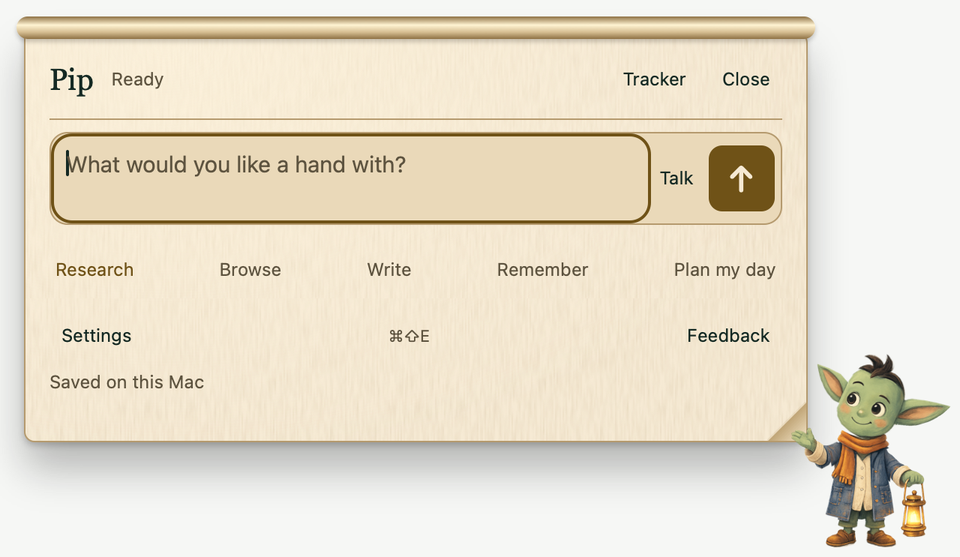

<div align="center">

# Pip

**A small macOS companion for remembered context, research and editable drafts.**

Experimental · Source build · [MIT code & docs](LICENSE)



[Get started](#get-started) · [Privacy](docs/PRIVACY.md) · [Documentation](docs/README.md) · [Contribute](CONTRIBUTING.md)

</div>

Pip keeps a small place for the context you choose to remember and the work you
choose to bring back. Summon it when you need it, review a fact before saving it,
and keep AI-generated writing editable rather than sending it automatically.

> **Experimental, not full v1 acceptance.** Build from source on macOS; the
> development app is unsigned and depends on its original project folder.
> There is no portable download, Homebrew installer or unattended-automation claim.

## See the account-free memory flow


*Automated disposable-profile demonstration in the real native app: Remember →
Review save → Save fact → saved list. The local save is real; no AI request occurs.
This is not physical-keyboard proof. The GIF plays once.*

[Static equivalent of the reviewed fact and saved list](docs/media/remember-static.png).
The recording demonstrates local memory, not secure deletion or live AI inference.

## What works today

| You want to… | Pip provides | Current boundary |
| --- | --- | --- |
| Remember a preference | Exact-text review, confirmed save, list, edit and Forget | Local storage is unencrypted; Forget is not secure erasure |
| Keep a draft close | Floating panel, menu-bar fallback and retained composer | Physical global-shortcut and ordinary Spaces proof retain gaps |
| Ask for research or a draft | Provider connection behind Allow, editable results and bounded follow-ups | Claude and ChatGPT have bounded live proof, not all-provider acceptance |
| Resume selected work | Approved project summaries, reference pins and reviewed Continue | References grant no access; not automatic project memory |
| Browse a public task | Isolated Chrome with Watch, private Take over and Return control | Read-only agent browsing; native/private-account journeys retain gaps |
| Dictate or share a window | Explicit device/context boundaries | Live dictation and screen capture/understanding are unfinished or unproved |
| Use Calendar, Reminders or notifications | Honest unavailable-state disclosure | These integrations are not connected |

See the [status and roadmap](docs/STATUS.md) for specific proof limits.

## Privacy before providers

Pip stores state on your Mac, but **not everything stays local**. An allowed
provider receives your request and approved context; public web research makes
external requests. Provider retention, account rules and billing still apply.


*Two deliberate crops from the same fresh-profile Allow screen, not a connected
account. Review sharing, routing and billing before Allow.
[Settings provider controls](docs/media/provider-settings.png) are also captured without credentials.*

- **Local state:** requests, drafts, facts, projects and backups are not encrypted.
  Restrictive permissions are not encryption. Forget does not erase historical
  records, backups or information already sent to a provider.
- **Provider choice:** Claude uses its installed program through the official SDK.
  OpenRouter follows your account’s routing/privacy settings; Pip adds no routing
  override. DeepSeek’s disclosure identifies servers in China. Their terms differ.
- **One named backup:** only an already-allowed backup may answer an initial
  availability failure. It is labelled; no third provider is tried. Partial answers
  and continuation limits wait for review rather than switching silently.
- **Credentials and effects:** provider secrets use a separate private file, not
  the renderer or application database. Allowing context sharing is not blanket
  permission to buy, send, submit, change accounts or use another integration.

OpenRouter/DeepSeek lack live-request proof. ChatGPT plan sign-in passed identity
and account-model checks in an isolated profile; a saved connection produced a
matching editable draft from public documentation. That is provider/output proof,
not physical-keyboard proof or universal plan/workspace eligibility.

The provider cancellation-preparation race is repaired in merged source, and a
token refresh that finds another request already refreshed now keeps the saved
connection. Stopping work cannot retract a request already sent; see
[status](docs/STATUS.md).

Read the complete [privacy boundary](docs/PRIVACY.md) before sharing sensitive data.

## Get started

### Requirements

- macOS 14 is the declared Swift-package minimum, not a fully tested compatibility
  matrix. See [installation](docs/INSTALLATION.md) for the actual preparation environment.
- Apple command-line developer tools, Node **22.19+**, npm and Python 3.
- Google Chrome for task browsing and UI tests.
- An AI connection only if you want AI work; remembering facts needs no account.

From a reviewed source checkout:

```sh
npm ci --ignore-scripts
npm run check
npm run build
npm start
```

Keep the project and dependencies in place. The build performs no signing,
Keychain access, Gatekeeper change, login registration or permission request.
Do not redistribute the machine-specific development app.

### Your first minute

1. Choose **Summon Pip** in the menu bar, or press **Command–Shift–E**. Settings
   lets you choose a different Command–Shift letter when a shortcut conflicts.
2. Choose **Remember**, enter “For this demo, I prefer tea.”, and choose
   **Review save**. Check the exact text, then choose **Save fact**.
3. Open **Settings → Remembered facts** to inspect the saved fact. Edit and Forget
   need confirmation; Forget is not secure deletion.
4. Press Escape to hide Pip and summon it again. Your unfinished draft remains.
5. For AI work, inspect the provider’s Allow screen before connecting and submitting.
   A missing connection should keep your request, not invent an answer.

[Detailed installation and checks](docs/INSTALLATION.md) ·
[Common problems and safe fixes](docs/TROUBLESHOOTING.md)

## How it fits together

```text
AppKit panel / menu bar        Native secure credential entry
           │                              │
      Bundled WebKit UI                   │
           └──────── Private-pipe Node service ────────┐
                           │                         │
                SQLite state + backups       Allow → chosen provider
                           │                         │
                  Selected context           one named allowed backup
                           │
             Public research / isolated task Chrome
```

Pip keeps the native host, web interface and local service separate. Page content
is untrusted evidence; a proposed action is not permission to execute it. Selected
result/project revisions bound context; interrupted work waits for reviewed Continue.

[Architecture and source map](docs/ARCHITECTURE.md) · [Trust boundaries](docs/PRIVACY.md)

## Questions and limitations

**Is this a finished assistant?** No. It is a source-dependent experimental build,
with explicit fixture/live/device proof gaps. See [status](docs/STATUS.md).

**Does my data always stay on my Mac?** No. Local state is unencrypted, while allowed
providers and external websites receive the described information and requests.

**Does Forget securely erase a fact?** No. It excludes the fact from future use;
historical records, backups and provider copies may remain.

**Can Pip send messages, buy things or manage my calendar?** No such completed
capability is claimed. The current browser path is read-only agent browsing;
Calendar, Reminders and notifications are unconnected.

**Is there a signed download or Homebrew package?** No. Build from a reviewed
checkout, keep its dependencies in place, and do not distribute the development app.

**Where do I report a problem?** Use a minimal disposable reproduction and follow
[contributing](CONTRIBUTING.md). Never post personal data, databases, keys or raw
traces. Suspected vulnerabilities belong in the [private security process](SECURITY.md).

## Roadmap and contributions

The near-term work is native/provider proof, truthful illustrated documentation,
qualified licensing/notices and a separately approved public-project setup.
Remaining device and context work needs its own scoped verification; roadmap items
are not release dates.

Small changes with realistic isolated behavior tests are welcome. Read
[CONTRIBUTING](CONTRIBUTING.md), the [code of conduct](CODE_OF_CONDUCT.md),
[security policy](SECURITY.md) and [Unreleased changelog](CHANGELOG.md).

## Credits and licenses

Maintained by **intelligentrascal**. Original code and documentation use the
[MIT license](LICENSE); third-party code and captured documentation keep their
[own notices and terms](THIRD_PARTY_NOTICES.md).

Eligible original artwork uses [CC BY 4.0](assets/LICENSE.md). The painted Curious
Hearth and smoke have AI-assisted provenance and local preparation. This notice does
not blanket-relicense those outputs; see [provenance and rights limitations](docs/ARTWORK.md).
No exclusive AI-art copyright, third-party endorsement or universal safety is claimed.

Public setup and synchronization are separate from this local package and require
[exact-content publication review](docs/PUBLICATION.md). Personal state and original
local history are never part of that synchronization.
